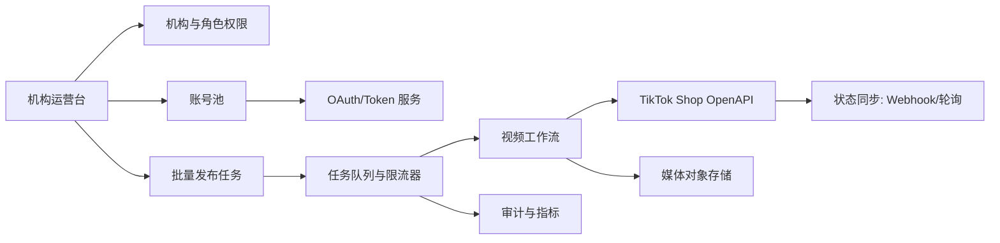

# 系统架构

## 设计原则

1. **账号隔离**：Creator 与 Seller/Shop 分离；每个账号独立 OAuth、Token、区域、权限和风险状态。
2. **任务化执行**：所有批量操作转成可追踪的任务和子任务，支持幂等、限流、重试和暂停。
3. **异步优先**：上传、预检、发布和状态查询采用状态机，不把一次 HTTP 成功误判为最终发布成功。
4. **最小权限**：按应用类别和实际业务申请 scope；发布操作至少需要 `creator.video.write`。
5. **可审计**：记录操作者、账号、商品、媒体、请求 ID、状态变化、失败码和重试原因；不记录 Secret 或完整 Token。

## 逻辑模块



## 核心领域对象

- `organization`: TSP 机构；未来如做 SaaS，再增加 tenant/customer 隔离。
- `user` / `role`: 机构内部操作者、管理员和只读角色。
- `account`: Creator 或 Seller/Shop 账号，包含 region、market、外部 ID、状态和归属。
- `authorization`: 账号授权记录，保存 token 的密文引用、过期时间、scope、授权时间、撤销状态。
- `shop` / `product`: 店铺和商品映射；商品可用性必须在发布前再次确认。
- `media_asset`: 视频文件、封面、校验结果、存储位置和生命周期。
- `publish_batch`: 批量发布计划；包含操作者、计划时间、并发和暂停策略。
- `publish_task`: 一个账号/视频/商品组合的可重试子任务，含幂等键、状态和 TikTok request/video ID。
- `audit_event`: 不可篡改的关键操作与状态记录。

## 视频发布状态机

```text
DRAFT -> UPLOADING -> UPLOADED -> PRECHECKING -> PRECHECK_PASSED
                                      |                    |
                                      v                    v
                                   FAILED              PUBLISHING
                                                           |
                                      +--------------------+------------------+
                                      v                                       v
                                   SUCCESS                              RETRYABLE_FAILURE
                                                                              |
                                                                              v
                                                                           RETRYING
```

平台应把 TikTok 返回的 `PROCESSING / SUCCESS / FAIL` 映射到内部终态，并保存原始错误码的脱敏版本。

## 批量编排要求

- 默认按账号限流，避免同一创作者被并发提交多个发布任务。
- 队列支持机构级、账号级和接口级并发上限。
- 幂等键建议由 `account_id + media_hash + product_id + campaign_id` 组合并加业务版本。
- Token 刷新采用集中服务，任务执行前检查过期时间；刷新失败进入 `AUTH_REQUIRED`，不无限重试。
- 外部 API 请求保存 `request_id`、HTTP 状态、TikTok code 和耗时，禁止记录认证头。
- Webhook 作为加速通道，轮询作为兜底；两者都必须幂等。

## 未决技术选型

数据库、消息队列、对象存储、前端框架、后端语言、密钥管理系统和部署方式均为 `TBD`，在 MVP 技术评审前确定。
